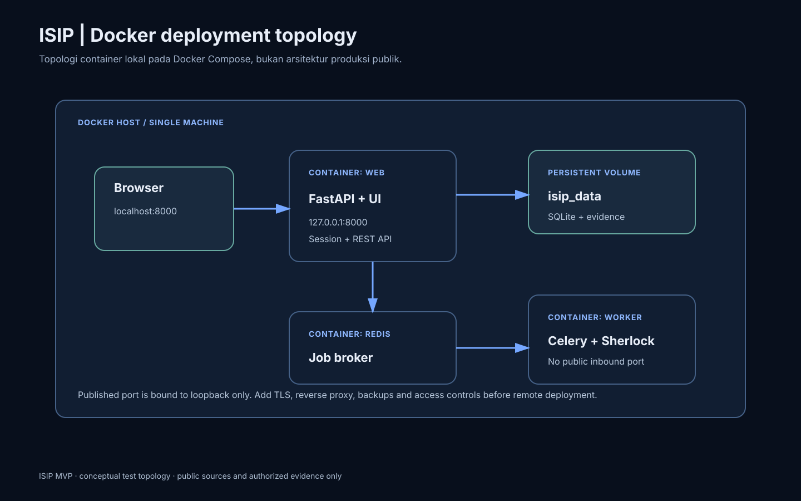
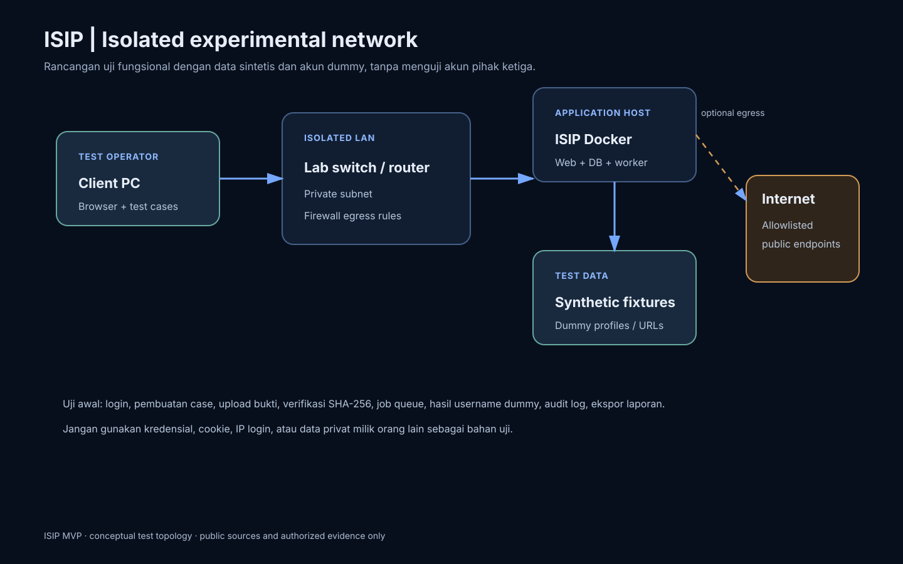
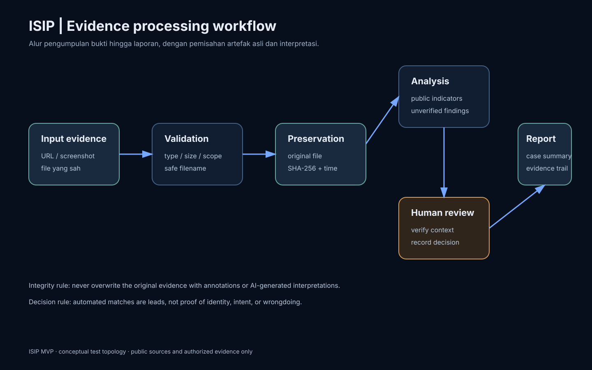

# ISIP topology diagrams

These diagrams describe the current MVP and a safe, isolated functional-test setup. They are design documentation, not evidence that the system has passed deployment or security testing.

## 1. Logical application architecture

FastAPI handles sessions, cases, evidence metadata, and reports. SQLite stores metadata; the persistent volume stores original evidence. Redis queues asynchronous jobs for the Celery worker. Sherlock checks public username presence. urlscan.io is an optional third-party submission and must remain disabled unless the operator explicitly enables it and confirms disclosure.

## 2. Docker deployment topology

The web port is bound to 127.0.0.1:8000. This is suitable for local testing only. A remote deployment needs HTTPS, reverse proxy configuration, restricted access, secret rotation, backups, monitoring, and a retention policy.

## 3. Isolated experimental network

Recommended experiment uses a private lab subnet, a dedicated client, an ISIP host, synthetic test profiles/URLs, and tightly controlled outbound access. Do not test with private data or credentials belonging to third parties.

### Suggested experiment matrix

| Test | Input | Expected observation |
|---|---|---|
| Authentication | Valid and invalid test credentials | Session created only for valid credentials |
| Case management | Synthetic case title and scope | Case appears in dashboard |
| Evidence integrity | Harmless test image or text file | SHA-256 recorded and reproducible |
| Upload validation | Unsupported extension / oversized file | Request rejected |
| Async username check | Reserved dummy test username | Job queued; any matches remain unverified |
| URL analysis | Harmless public test URL | Third-party submission only after explicit confirmation |
| Audit trail | Login, case creation, upload | Events recorded with timestamp and actor |
| Reporting | Case with test evidence | JSON report contains evidence hash and findings |

## 4. Evidence workflow

Keep original evidence immutable in the operational process. Store analyst notes and automated interpretations separately. Every finding must retain its source and verification status.

## Safety and interpretation

- A username found on multiple public websites is not proof that one person controls all those accounts.
- Do not attempt to obtain hidden email addresses, login IPs, GPS coordinates, device identifiers, passwords, or private content.
- Do not bypass platform controls or scrape authenticated sessions.
- Treat automated output as an investigative lead requiring human verification.